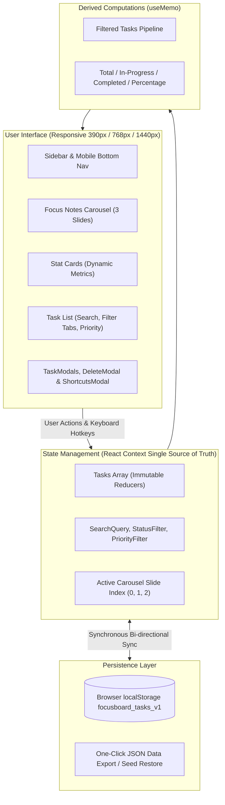

# FocusBoard — Task Dashboard

FocusBoard is a responsive, single-user task dashboard built with **React**, **TypeScript**, and **Tailwind CSS**, designed directly from the Figma design specifications.

---

## 🚀 Live Demo & Repository
- **GitHub Repository:** [https://github.com/vamsikiran1234/FocusBoard](https://github.com/vamsikiran1234/FocusBoard)
- **Live Deployment:** Ready for zero-config deployment on Vercel / Netlify (configuration file `vercel.json` included).

---

## 📋 Final Submission Details
- **Candidate:** Vamsi Kiran
- **Framework:** React 18 + Vite + TypeScript + Tailwind CSS
- **GitHub Source:** [https://github.com/vamsikiran1234/FocusBoard](https://github.com/vamsikiran1234/FocusBoard)
- **Hosted URL:** Ready to deploy via GitHub to Vercel/Netlify.
- **AI Usage:** Documented in [AI_USAGE.md](./AI_USAGE.md).

---

## 🏛️ System Architecture & Data Flow



---

## ⚡ Power-User Keyboard Shortcuts

| Shortcut | Action | Description |
| :---: | :--- | :--- |
| <kbd>N</kbd> | **New Task** | Instantly opens the Create Task modal from anywhere |
| <kbd>/</kbd> | **Focus Search** | Jumps focus directly to the task search input |
| <kbd>1</kbd>, <kbd>2</kbd>, <kbd>3</kbd> | **Carousel Slide** | Navigates directly to Focus Notes slide 1, 2, or 3 |
| <kbd>?</kbd> | **Shortcuts Guide** | Opens the interactive Keyboard Shortcuts cheat sheet |
| <kbd>Esc</kbd> | **Dismiss** | Closes any open modal or dropdown menu |

---

## ✨ Features & Rubric Compliance

### 1. Visual & Pixel-Perfect Fidelity (Figma Source of Truth)
- **Desktop (1440 × 1000 px):**
  - Left sidebar navigation with Workspace section, active state pill (`#EEF2FF`), and branding.
  - Top header with workspace breadcrumbs (`Workspace / Overview`) and user profile avatar (`JD`).
  - Hero header with "Your work, in focus." and primary action button "New task".
  - **Focus Notes Carousel** banner with gradient styling, slide index badge (`FOCUS NOTES 01 / 03`), floating tilted card preview, progress bar, and circular navigation controls.
  - **3 Overview Summary Cards** (Total tasks, In progress, Completed) with custom icons, badges, and dynamic stats.
  - **Task List** with search bar, status tabs, priority dropdown, category pills, priority badges, and three-dot action dropdowns.
- **Tablet (768 px):** Reflowed multi-column layout, responsive card wrapping, and accessible touch targets without horizontal clipping.
- **Mobile (390 × 1128 px):**
  - Mobile header with logo and avatar.
  - Stacked mobile task cards with touch-friendly check toggle and actions.
  - Floating `+` action button.
  - Fixed mobile bottom navigation bar (`Overview`, `Tasks`, `Calendar`, `Settings`).

### 2. State Management & Data Architecture
- **Single Source of Truth:** Centralized `TaskContext` stores the task array, search query, status filters, priority filters, active carousel slide, and modal states.
- **Predictable Mutations:** All operations (`addTask`, `updateTask`, `deleteTask`, `toggleTaskStatus`, `setTaskStatus`) use immutable state patterns.
- **Derived Values:** Statistics (total, in-progress, completed, and completion percentage) and filtered task lists are calculated dynamically via `useMemo` and never hardcoded.
- **Browser Persistence:** Tasks are safely persisted to `localStorage` under `focusboard_tasks_v1`. On first launch, 12 rich sample tasks are loaded. On browser refresh, user changes are fully preserved without being overwritten.
- **Reset Sample Data:** A "Reset sample data" button is provided in the sidebar to conveniently restore the original Figma sample tasks at any time.

### 3. Focus Notes Carousel (All 3 Figma Slides)
- **Slide 1 (15:2):** "Make today count." / "A little focus goes a long way." (Card: "NEXT UP" — Design landing page, 62%)
- **Slide 2 (15:30):** "Small steps, big progress." / "Keep your priorities in view." (Card: "IN PROGRESS" — Fix navigation, 67%)
- **Slide 3 (15:58):** "Celebrate the wins." / "Every completed task moves you forward." (Card: "COMPLETED" — Onboarding copy, 100%)
- **Controls:** Previous and Next buttons, interactive dash indicators with active white pill state.

### 4. Task Operations & Modals
- **Create Task Form (Figma 760 × 822):**
  - Validates required title with inline error messaging.
  - Multi-line description field.
  - Status selector (`To do`, `In progress`, `Completed`).
  - Priority selector (`Low`, `Medium`, `High`).
  - Category selector (`Design`, `Development`, `Content`, `Research`, `Marketing`, `Operations`).
  - Due date picker.
- **Edit Task Modal:** Pre-populates existing task data and updates cleanly.
- **Delete Confirmation Dialog:** Requires confirmation before permanently deleting a task.
- **Quick Status Toggle:** Clicking the circular checkbox toggles between incomplete and completed instantly.

### 5. Accessibility (a11y)
- Semantic HTML tags: `<header>`, `<aside>`, `<main>`, `<nav>`, `<article>`, `<button>`.
- Accessible dialog semantics (`role="dialog"`, `aria-modal="true"`, `aria-labelledby`).
- Keyboard controls: `Escape` key closes all modals; form inputs receive autofocus.
- Accessible ARIA labels on all icon buttons (`aria-label`, `aria-pressed`, `aria-selected`).

---

## 🛠️ Tech Stack
- **Framework:** React 18
- **Language:** TypeScript
- **Bundler:** Vite 6
- **Styling:** Tailwind CSS 3
- **Icons:** Lucide React
- **Testing:** Vitest + React Testing Library + JSDOM

---

## 📦 Getting Started

### Prerequisites
- Node.js (v18 or higher recommended)
- npm or pnpm

### Installation
```bash
# Clone the repository
git clone https://github.com/vamsikiran1234/FocusBoard.git
cd FocusBoard

# Install dependencies
npm install
```

### Running Locally
```bash
npm run dev
```
Open [http://localhost:5173](http://localhost:5173) in your browser.

### Running Tests
```bash
npm run test
```
Runs 14 automated unit and integration tests covering statistics, filtering, carousel navigation, and CRUD workflows.

### Production Build
```bash
npm run build
```
Creates an optimized production bundle in the `dist` directory.

---

## 🧪 Verification & Evaluator Testing Checklist

| Test Item | Action | Expected Result |
| :--- | :--- | :--- |
| **Carousel Navigation** | Click Next / Prev arrows or bottom dash indicators. | Transitions smoothly through all 3 Figma slides with matching card details and indicator highlights. |
| **Create Task** | Click "New task", leave title empty, submit. | Displays inline error `"Task title is required."` |
| **Create Valid Task** | Enter title `"Launch v1.0"`, choose Priority High, submit. | New task appears at top of list; Total tasks count increments immediately; toast appears. |
| **Dynamic Statistics** | Click checkbox on any In-progress task. | Marks task as completed; "In progress" count decrements, "Completed" count increments, and percentage updates automatically. |
| **Search & Filters** | Type `"design"` in search; toggle `"Completed"` tab; change priority to `"High"`. | Displays only matching tasks in real-time with case-insensitivity. |
| **Edit Task** | Click `...` menu on any task -> "Edit task", modify title. | Updates task details and updates UI immediately. |
| **Delete Task** | Click `...` menu -> "Delete task". | Displays confirmation dialog; confirming removes task and updates total count. |
| **Persistence** | Refresh the browser page (`F5`). | All created, edited, and deleted tasks remain exactly as saved in `localStorage`. |
| **Reset Data** | Click "Reset sample data" at bottom of sidebar. | Restores original 12 Figma tasks. |
| **Responsiveness** | Resize browser window to `390px` (mobile), `768px` (tablet), `1440px` (desktop). | Fluid layout, stacked mobile cards, bottom mobile nav, no horizontal scrolling. |
