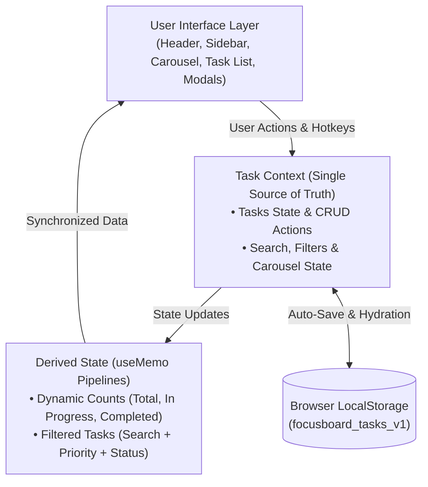

# FocusBoard — Single-User Task Dashboard

[](https://react.dev/)
[](https://www.typescriptlang.org/)
[](https://vitejs.dev/)
[](https://tailwindcss.com/)
[](https://vitest.dev/)
[](https://www.w3.org/WAI/standards-guidelines/wcag/)

> **FocusBoard** is a responsive, accessible single-user task management dashboard built to match the official Figma design specifications with pixel-accurate layout fidelity, smooth transitions, and persistent local storage.

---

## 📋 Submission Details

| Field | Detail |
| :--- | :--- |
| **Candidate** | Vamsi Kiran |
| **Framework** | React 18 + Vite + TypeScript + Tailwind CSS |
| **GitHub Repository** | [https://github.com/vamsikiran1234/FocusBoard](https://github.com/vamsikiran1234/FocusBoard) |
| **Deployment** | Configured for zero-config live deployment on **Vercel** / **Netlify** (`vercel.json` included) |
| **AI Usage Disclosure** | Documented in [`AI_USAGE.md`](./AI_USAGE.md) |
| **Test Coverage** | 20 / 20 tests passing across 5 test suites (`npm test`) |

---

## 🏛️ System Architecture

FocusBoard follows a clean, single source of truth architecture using React Context, derived `useMemo` computations, and automatic browser storage persistence:



### Architecture Overview

1. **Centralized State (`TaskContext`):** All core application states (task list, active filters, search query, active carousel slide, modal visibility) live inside `TaskContext`, eliminating prop-drilling.
2. **Derived Computations (`useMemo`):** Overview statistics (total, completed, in-progress) and filtered task lists are computed on the fly from the task array. This prevents state desynchronization bugs.
3. **Storage Persistence:** Any state modification (adding, editing, toggling, or deleting a task) is immediately synchronized to `localStorage`. If all tasks are deleted, the empty state is preserved across reloads.
4. **Responsive Views:** Desktop, tablet, and mobile layouts share the exact same state and business logic while rendering optimized viewports.

---

## 🎨 Figma Specification Mapping

The visual implementation maps directly to the live Figma design frames:

| Figma Frame ID | Resolution | Figma View | Implementation Details |
| :--- | :--- | :--- | :--- |
| **Frame 1:2** | `1440 × 1000` | *Desktop Dashboard* | Sidebar navigation, breadcrumbs, tilted card carousel (+2.5°/-2.5°), 3 overview cards, search bar, status tabs, and task rows. |
| **Frame 1:167** | `390 × 1128` | *Mobile Dashboard* | Mobile header with squircle logo and user avatar, 2-line title, compact focus banner with inline progress, 2 overview cards, stacked cards, and bottom nav. |
| **Frame 1:279** | `760 × 822` | *Create-task form* | Centered modal with Title (required with inline validation), Description, Status, Priority, Due Date with custom calendar trigger, and cancel/create buttons. |
| **Frame 15:2** | `1106 × 152` | *Focus Notes — Slide 1* | "Make today count." / "A little focus goes a long way." (Card: "NEXT UP" — Design landing page, 62%). |
| **Frame 15:30** | `1106 × 152` | *Focus Notes — Slide 2* | "Small steps, big progress." / "Keep your priorities in view." (Card: "IN PROGRESS" — Fix navigation, 67%). |
| **Frame 15:58** | `1106 × 152` | *Focus Notes — Slide 3* | "Celebrate the wins." / "Every completed task moves you forward." (Card: "COMPLETED" — Onboarding copy, 100%). |

---

## ⚡ Keyboard Shortcuts

FocusBoard includes a complete keyboard navigation engine for power users:

| Shortcut | Action | Behavior |
| :---: | :--- | :--- |
| <kbd>N</kbd> | **New Task** | Opens the Create Task modal from anywhere in the application. |
| <kbd>/</kbd> | **Focus Search** | Instantly focuses the task search input. |
| <kbd>1</kbd>, <kbd>2</kbd>, <kbd>3</kbd> | **Slide Switch** | Jumps directly to Focus Notes slide 1, 2, or 3. |
| <kbd>?</kbd> | **Shortcuts Guide** | Opens the interactive Keyboard Shortcuts cheat sheet dialog. |
| <kbd>Esc</kbd> | **Dismiss** | Closes any open modal or dropdown menu. |

*(Shortcuts automatically disable when typing inside an input, textarea, or select field).*

---

## 💡 Key Engineering Details

- **Derived State Over Redundant State:** Task counts (`Total`, `In progress`, `Completed`) are derived dynamically using `useMemo` rather than stored in separate state variables, ensuring counts never get out of sync.
- **Empty State Preservation in LocalStorage:** Uses `if (stored !== null && Array.isArray(parsed))` so that if a user deletes all tasks, an empty dashboard persists across page reloads instead of resetting back to sample data.
- **Isolated DOM Refs for Menus:** Separated `desktopMenuRef` and `mobileMenuRef` in `TaskItem.tsx` with `onMouseDown={(e) => e.stopPropagation()}` to prevent outside-click listeners from prematurely closing the action menu on desktop viewports.
- **Data Export:** Includes an **"Export JSON"** button in the sidebar to download a timestamped backup of all tasks (`focusboard_tasks_YYYY-MM-DD.json`).

---

## 🧪 Verification & Feature Checklist

You can verify all features using the checklist below:

| # | Feature | Action | Expected Result |
| :---: | :--- | :--- | :--- |
| **1** | **Carousel Navigation** | Click next/prev arrow buttons or press <kbd>1</kbd>, <kbd>2</kbd>, <kbd>3</kbd>. | Carousel transitions between all 3 slides; active indicator updates; card preview reflects slide data. |
| **2** | **Task Validation** | Click "New task" (or press <kbd>N</kbd>), leave Title empty, and submit. | Submission is blocked; inline error *"Task title is required."* appears in red; input receives focus. |
| **3** | **Task Creation** | Enter a title, choose Priority, and submit. | Modal closes; new task appears at top of list; Total counter increments; toast confirms addition. |
| **4** | **Status Toggling** | Click the circular checkbox on any task row. | Task toggles between In Progress and Completed; counters and progress bar update in real time. |
| **5** | **Multi-Condition Search** | Type in search bar, select a status tab, and choose a priority filter. | Task list updates instantly matching all active filter criteria. |
| **6** | **Edit Task** | Click `···` menu on a task → select *"Edit task"*. | Modal opens pre-populated with task data; saving updates the task immediately. |
| **7** | **Delete Task** | Click `···` menu → select *"Delete task"*. | Destructive confirmation dialog opens; confirming removes the task and decrements counters. |
| **8** | **Persistence on Refresh** | Create or edit tasks, then refresh the page (<kbd>F5</kbd>). | All changes, status toggles, and deletions remain intact from `localStorage`. |
| **9** | **Reset Sample Data** | Click *"Reset sample data"* in the sidebar. | Safely restores the initial 12 Figma tasks. |
| **10** | **Keyboard Shortcuts** | Press <kbd>?</kbd> on any screen. | The interactive Keyboard Shortcuts cheat sheet modal appears. |

---

## 🛠️ Getting Started

### Prerequisites
* **Node.js**: v18.0.0 or higher
* **Package Manager**: npm, pnpm, or yarn

### Installation
```bash
# 1. Clone the repository
git clone https://github.com/vamsikiran1234/FocusBoard.git
cd FocusBoard

# 2. Install dependencies
npm install
```

### Running Locally
```bash
npm run dev
```
Open **[http://localhost:5173](http://localhost:5173)** in your browser.

### Running Automated Tests
```bash
npm test
```
Executes all **20 automated unit and integration tests** in Vitest.

### Production Build
```bash
npm run build
```
Compiles TypeScript and bundles production assets into `dist/`.

---

## 📄 License
This project is licensed under the [MIT License](LICENSE).
